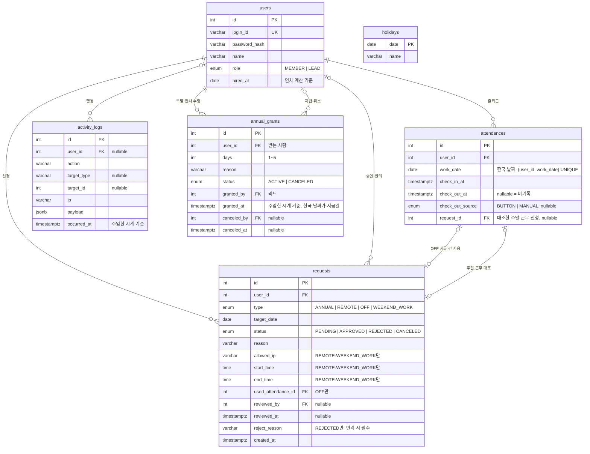
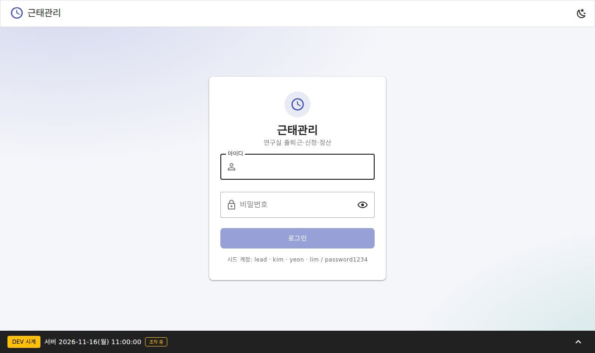
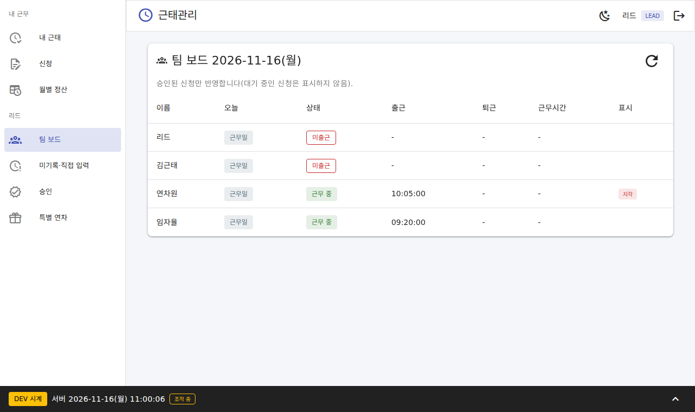
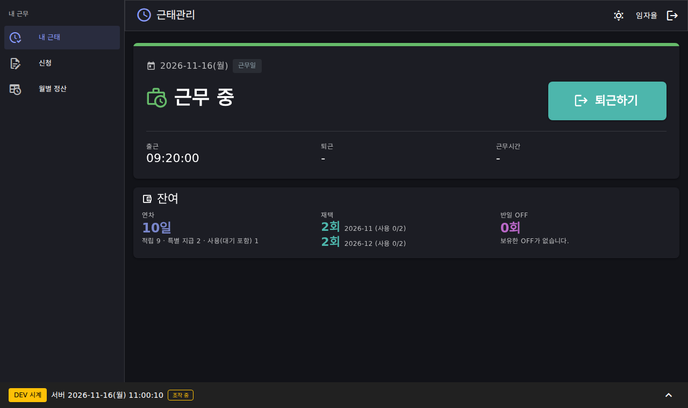

# 근태관리 시스템

[](https://github.com/YunTaeKyun93/hiconsy-attendance/actions/workflows/ci.yml)

팀 내부 근태관리 웹 애플리케이션. 출퇴근, 연차·재택·반일 OFF·주말 근무 신청과 승인, 잔여 조회, 팀 보드, 월별 정산, 신청서 PDF를 제공한다.

- 설계 기준: [docs/DESIGN.md](docs/DESIGN.md). 이 README의 규칙·설계 이유는 요약이고, 자세한 근거는 DESIGN.md에 있다(제도 해석 4~7장, 데이터 모델 2장, 결정 13장, 선택 기능 14장).
- 제출 필수 항목: [프로젝트 실행 방법](#프로젝트-실행-방법) · [기술 스택 및 선택 이유](#기술-스택-및-선택-이유) · [아키텍처 및 컨벤션](#아키텍처-및-컨벤션) · [데이터베이스 스키마 구조 및 설계 이유](#데이터베이스-스키마-구조-및-설계-이유) · [개발 시 고민했던 점 또는 아쉬운 점](#개발-시-고민했던-점-또는-아쉬운-점)

## 프로젝트 실행 방법

### 평가자 빠른 시작

1. [Node.js 24 이상](https://nodejs.org/)과 [Docker](https://www.docker.com/)(Windows는 Docker Desktop)를 설치하고 Docker를 켠다.
2. 저장소 루트에서 `npm run setup` (설치 → DB 실행 → 마이그레이션 → 시드)
3. `npm run dev` 후 <http://localhost:5173> 접속, 계정 `lead` / `password1234` (팀원은 `kim` 등, [시드 계정](#시드-계정))

### 준비물

- Node.js 24 이상 (`.nvmrc`)
- Docker (PostgreSQL만 컨테이너로 띄운다. Windows는 Docker Desktop)

### 명령어

```bash
npm run setup   # .env 생성 → 의존성 설치 → DB 실행 → 빌드 → 마이그레이션 → 시드
npm run dev     # DB 실행 확인 후 API(:3000)와 화면(:5173)을 함께 실행
```

브라우저에서 <http://localhost:5173> 으로 접속한다.

- `npm run setup`은 여러 번 실행해도 안전하다(이미 있는 `.env`, 계정, 공휴일은 건너뜀).
- `.env`는 `.env.example`을 복사해 만들고 `JWT_SECRET`을 무작위 값으로 채운다.
- 스크립트는 bash 전용 문법 없이 작성해 Windows에서도 같은 명령어로 동작한다.

### 그 밖의 명령어

| 명령어 | 설명 |
| --- | --- |
| `npm run test -w backend` | 단위 테스트(vitest). 서버 OS 시간대 의존을 잡으려고 `TZ=America/Los_Angeles`에서 돈다 |
| `npm run sync:holidays` | 공휴일 동기화(공공데이터포털 특일 정보 API). `.env`의 `HOLIDAY_API_KEY`가 없으면 안내 후 종료 |
| `npm run test:e2e` | 핵심 흐름 E2E(Playwright): 로그인 → 출근 → 퇴근 → 신청 → 리드 승인 → IP 차단 화면, 재택 흐름(연구실에서 신청·승인 → 내부망 IP로 본인 출근, 다른 팀원 거부, 시간대 밖 차단). 처음 한 번 `npx playwright install chromium` |
| `npm run test:e2e:force` | 위와 같되 DB에 기존 데이터가 있어도 진행 |
| `npm run screenshots` | README 주요 화면 스크린샷을 다시 찍는다(`docs/screenshots/`). 데이터 확인 규칙은 E2E와 같다(`screenshots:force`) |

E2E는 개발 모드 시계 API로 시각을 맞추고, 시작과 끝에 테스트 데이터 초기화 API로 출퇴근·신청·특별 연차·이력을 지운다. 그래서 **시작 전에 DB를 확인해 기존 데이터가 있으면 멈춘다**(지워도 되면 `:force`). 앱이 떠 있지 않으면 `npm run dev`로 띄운다. IP 차단·재택 테스트는 이 기계의 내부망 IPv4로 접속하며, 없으면 건너뛴다.

### 환경 변수 (`.env`)

| 이름 | 설명 |
| --- | --- |
| `DB_HOST` `DB_PORT` `DB_USER` `DB_PASSWORD` `DB_NAME` | PostgreSQL (docker-compose와 공유) |
| `PORT` | API 포트 (기본 3000) |
| `NODE_ENV` | `production`이면 개발 모드 도구(시계 조작, 테스트 데이터 초기화)가 등록되지 않는다 |
| `LAB_IPS` | 연구실 IP 목록(쉼표 구분). 기본 `127.0.0.1,::1` |
| `JWT_SECRET` | 로그인 토큰 서명 키. setup이 생성 |
| `JWT_EXPIRES_HOURS` | 로그인 유지 시간. `.env.example`은 개발용 168(7일), 운영은 12 권장(값이 없으면 12) |
| `HOLIDAY_API_KEY` | 공휴일 동기화 CLI 전용. 앱 실행에는 필요 없음 |

### 시드 계정

비밀번호는 모두 `password1234`.

| 아이디 | 이름 | 역할 | 입사일 |
| --- | --- | --- | --- |
| `lead` | 리드 | LEAD | 2026-01-01 (발문에 없어 팀 창설일로 설정) |
| `kim` | 김근태 | MEMBER | 2026-01-01 |
| `yeon` | 연차원 | MEMBER | 2026-01-15 |
| `lim` | 임자율 | MEMBER | 2026-02-12 |

공휴일은 2026~2027년 데이터가 저장소에 들어 있다(`backend/data/holidays.seed.json`). 네트워크 없이 시드된다.

### 둘러보기

| 화면 | 누가 | 내용 |
| --- | --- | --- |
| 내 근태 | 전원 | 오늘 날짜 유형, 출근·퇴근·근무시간, 지각·조퇴·직접 입력 표시, 근무 중이면 정상 퇴근 가능 시각, 출퇴근 버튼, 잔여(연차·재택·OFF). 미기록 퇴근이 있으면 입력 모달이 자동으로 열린다 |
| 신청 | 전원 | 신청서, 내 신청 목록(취소, 신청서 PDF) |
| 월별 정산 | 전원 | 팀원은 본인, 리드는 전원 요약 + 행을 누르면 일별 상세 |
| 팀 보드 | 리드 | 오늘 팀원별 날짜 유형과 출근 상태 |
| 미기록·직접 입력 | 리드 | 월별 미기록 건과 직접 입력 건 |
| 승인 | 리드 | 대기 신청 승인·반려, 신청서 PDF |
| 특별 연차 | 리드 | 팀원에게 특별 연차 지급(1~5일), 지급 내역과 취소 |

- 8시간 근무 = 점심 포함 보통 9시간(예: 09:59:34 출근 → 18:59:34부터 정상 퇴근). 11:30을 넘겨 출근하면 점심 차감이 없어 8시간이다.

#### 개발 모드 시계

개발 모드에서는 화면 하단 **DEV 시계** 막대로 서버 시각을 바꿀 수 있다(운영 모드에서는 API와 막대 모두 없음). 지정한 시각부터 시계가 계속 흐른다.

- 시각은 24시간으로 입력하고 Enter로 바로 적용한다(예: 1830). 날짜를 비우면 서버 날짜에 시각만 적용한다.
- 빠른 버튼: 07:00, 09:59:30(정상 출근 확인), 10:00:30(지각 확인), 12:00, 16:00, 17:00, 18:30, ±1일, +1시간, 다음 평일, 다음 토요일, 실제 시각으로
- **10:00:00 정각 경계는 단위 테스트로 검증**한다(`backend/src/domain/attendance-rules.spec.ts`의 `isLate (지각 경계)`). 시계가 흐르기 때문에 화면에서 10:00:00을 맞춘 뒤 버튼을 누르면 이미 지각이 된다.
- **테스트 데이터 초기화** 버튼: 출퇴근·신청·특별 연차·이력을 모두 지우고 시계를 실제 시각으로 되돌린다. 사용자와 공휴일은 유지된다(확인 창이 뜬다). "행을 삭제하지 않는다" 원칙의 유일한 예외이며 개발 모드 전용이다.
- 로그인 토큰 만료도 이 시계를 따른다. 7일 넘게 앞으로 옮기면 다시 로그인해야 한다.
- 시각은 서버 메모리에만 있어 서버를 다시 켜면 실제 시각으로 돌아간다. 막대는 5초마다(탭으로 돌아올 때도) 서버 시각을 다시 확인해, 재시작·다른 탭·API로 시계가 바뀌면 맞추고 화면 데이터를 다시 불러온다.

#### 재택(IP) 테스트

기본 `LAB_IPS`는 `127.0.0.1,::1`이라 `localhost`로 접속하면 연구실로 취급되고, 내부망 IP로 접속하면 "집"이 된다.

실제로 검증한 방법(서버를 띄운 WSL 터미널에서):

```bash
# 내부망 IP 확인 (예: 192.168.0.14)
hostname -I

# X-Forwarded-For를 연구실 IP로 위조해 내부망 IP로 요청 → 403 (위조 헤더로 우회되지 않음)
curl -H "X-Forwarded-For: 127.0.0.1" http://192.168.0.14:5173/api/auth/me
# {"statusCode":403,"code":"IP_NOT_ALLOWED","message":"등록된 IP가 아닙니다."}

# localhost는 연구실 → 403이 아니라 401(로그인 필요)
curl http://localhost:5173/api/auth/me
```

재택 승인 후 흐름: `localhost`에서 `kim`으로 재택 신청(접속 IP에 내부망 IP) → `lead`로 승인 → 시계를 재택 시간대 안으로 → 내부망 IP로 접속하면 `kim`만 통과한다.

Windows 브라우저에서 WSL의 내부망 IP로 접속하는 것은 WSL 네트워크 설정(NAT·미러 모드, 방화벽)에 따라 안 될 수 있다. 그때는 위의 curl로 확인한다.

## 기술 스택 및 선택 이유

인증 방식 결정 근거: [DESIGN.md 13장](docs/DESIGN.md#13-구현-전-결정).

| 기술 | 선택 이유 |
| --- | --- |
| NestJS (백엔드) | 과제 필수. 전역 가드 순서·모듈·DI로 IP 가드와 Clock 주입을 깔끔하게 걸 수 있다 |
| Vue 3 · Vite · TypeScript · Pinia · Vue Router (프론트) | 과제 필수. Vite 개발 서버의 프록시가 API와 같은 출처를 만들어 쿠키 인증이 단순해진다 |
| TypeORM | `@Index({ unique: true, where })`로 부분 인덱스를 엔티티에 선언하고 마이그레이션으로 관리할 수 있다. 써 본 ORM이라 익숙하다 |
| PostgreSQL | 부분 UNIQUE 인덱스(`status IN ('PENDING','APPROVED')`)로 같은 날짜 중복 신청·OFF 지급 건 중복 사용을 동시 요청에서도 DB가 막아 준다. `timestamptz`·`jsonb`도 쓴다 |
| Vuetify | 표·폼·다이얼로그·날짜 입력을 기본으로 제공해 화면 구현 시간을 줄인다 |
| JWT + httpOnly 쿠키 | IP·시간대를 요청마다 가드가 다시 검사하므로 토큰 강제 폐기(세션 저장소)가 필요 없다. httpOnly라 스크립트(XSS)로 토큰을 빼 갈 수 없다. `SameSite=Strict` |
| scrypt (`node:crypto`) | Node 내장이라 bcrypt 같은 네이티브 모듈 빌드 문제가 없다(Windows 평가 환경 고려) |
| vitest · Playwright | vitest로 domain 순수 함수 단위 테스트(서버 시간대 의존을 잡으려고 `TZ=America/Los_Angeles`에서 실행), Playwright로 핵심 흐름 E2E |
| Docker (DB만) | 앱까지 컨테이너에 넣으면 요청이 Docker 네트워크를 거쳐 들어와 클라이언트 IP가 바뀌므로 IP 검사가 깨진다. 그래서 PostgreSQL만 컨테이너로 띄우고 앱은 로컬에서 실행한다 |

## 아키텍처 및 컨벤션

### 인프라

로컬 한 대에서 도는 구성이다.

```
 브라우저 (localhost 또는 내부망 IP)
    │  http://<host>:5173
    ▼
 Vite 개발 서버 :5173 ── 화면(Vue) 제공
    │  /api 프록시 (xfwd: X-Forwarded-For에 실제 클라이언트 IP)
    ▼
 NestJS API :3000  (trust proxy = 'loopback': 루프백 프록시가 붙인 헤더만 믿음)
    │  TypeORM
    ▼
 PostgreSQL :5432 (Docker 컨테이너, 데이터 볼륨)

 공공데이터포털 특일 API ◀── npm run sync:holidays (CLI, 수동) ──▶ 시드 파일 커밋 → holidays 테이블
```

- 공휴일 API는 **CLI 동기화로만** 부른다. 요청 처리 중에는 외부 API를 부르지 않고 `holidays` 테이블만 읽는다. 서버 시작 시 테이블이 비어 있으면 저장소의 시드 파일로 채운다.
- 연구실 IP는 env `LAB_IPS`로 주입한다(DB에 두지 않음).

### 소스 코드

요청 한 건이 지나가는 순서다. 전역 가드 순서는 `backend/src/app.module.ts`에 고정되어 있다.

```
요청
 → ① IP 1단계 가드   모든 요청(로그인 전 포함). 연구실 IP 또는 지금 시간대 안의 승인된 재택·주말 근무 신청 IP인가
 → ② JWT 가드        httpOnly 쿠키의 토큰 검증(@Public 제외), 만료는 주입한 시계 기준
 → ③ IP 2단계 가드   연구실 밖이면 그 신청이 로그인한 본인 것인가(로그인 요청에도 적용)
 → ④ 역할 가드       @Roles('LEAD')가 붙은 API만
 → 컨트롤러          입력 형식 확인, 서비스 호출
 → 서비스            DB에서 사실(출퇴근 행·신청·공휴일)을 읽고, Clock에서 현재 시각을 얻고, 트랜잭션·잠금, 이력 기록
 → domain 순수 함수  판정·계산(날짜 유형, 지각·조퇴, 근무시간, 잔여, 기한, OFF 선택). DB·시계 없이 입력만 받는다
 → DB                결과(사실)만 저장
```

| 계층 | 위치 | 역할 |
| --- | --- | --- |
| 가드 | `access/`, `auth/` | IP 2단계, JWT, 역할. 거절은 403/401 + 이력(상태 변경 요청만) |
| 컨트롤러 | `*/*.controller.ts` | 라우팅과 입력 형식 확인만. 판정 로직 없음 |
| 서비스 | `*/*.service.ts` | 조회 → domain 함수 호출 → 저장 → 이력. 동시 요청 처리(행 잠금, 기대 상태일 때만 UPDATE) |
| domain | `domain/` | 순수 함수와 `*.spec.ts`. DESIGN.md 예시 표를 전부 테스트로 옮김 |
| 공통 | `common/`, `clock/` | 날짜·시각 유틸(Asia/Seoul, 한 모듈), Clock provider(운영: 실제 시계, 개발: 조작 가능) |
| 이력 | `activity-log/` | 쓰기 전용. 행동별 `payload`는 유니언 타입 |

```
├── package.json          setup, dev 스크립트 (concurrently)
├── docker-compose.yml    PostgreSQL만
├── scripts/ensure-env.mjs
├── e2e/                  Playwright E2E, 스크린샷
├── backend/
│   ├── assets/fonts/     신청서 PDF용 한글 폰트
│   ├── data/             공휴일 시드
│   ├── lint/             Clock 규칙 커스텀 린트
│   └── src/
│       ├── domain/       판정·계산 순수 함수와 테스트
│       ├── common/       날짜·시각 유틸(Asia/Seoul), 요청 문맥, 비밀번호 해시
│       ├── clock/        Clock provider (운영: 실제 시계, 개발: 조작 가능)
│       ├── access/       IP 2단계 가드
│       ├── auth/         로그인(JWT httpOnly 쿠키), 역할
│       ├── attendance/   출퇴근, 팀 보드, 미기록 목록
│       ├── requests/     신청, 승인·반려, 잔여, 신청서 PDF
│       ├── settlements/  월별 정산
│       ├── annual-grants/ 리드의 특별 연차 지급·취소
│       ├── activity-log/ 이력(쓰기 전용)
│       ├── holidays/     공휴일 조회·시드
│       ├── database/     엔티티, 마이그레이션
│       ├── dev/          개발 모드 도구(시계, 초기화)
│       └── cli/          시드, 공휴일 동기화
├── frontend/src/         views(화면), components, stores(Pinia), api(fetch 래퍼)
└── docs/                 DESIGN.md, AI_REVIEW.md, screenshots
```

### 컨벤션

- **커밋 메시지**: `타입: 한국어 요약`. 타입은 `feat`(기능), `fix`(버그·동작 수정), `test`(테스트), `docs`(문서), `chore`(설정·세팅). 그 밖에 `style`(겉모습만), `ci`, `data`(공휴일 시드)를 썼다. Phase 단위로 사람이 확인한 뒤 커밋했다.
- **폴더·파일 이름**: 백엔드는 기능별 폴더에 kebab-case + 역할 접미사(`attendance.service.ts`, `attendance.controller.ts`, `attendance-errors.ts`, `request.entity.ts`). 테스트는 대상 옆에 `*.spec.ts`. 프론트 컴포넌트는 PascalCase, 화면은 `*View.vue`.
- **domain은 DB 없는 순수 함수**: 현재 시각·공휴일·신청 목록을 인자로 받는다. 그래서 경계값을 DB 없이 테스트한다.
- **시각은 Clock에서만**: 인자 없는 `new Date()`, `Date.now()`, SQL `now()`, `@CreateDateColumn`·`@UpdateDateColumn`을 커스텀 린트(`backend/lint/clock-plugin.js`, CI에서 실행)로 막는다. 시각 칸은 서비스가 Clock 값으로 채운다. 판정은 Asia/Seoul 기준이고 서버 OS 시간대에 의존하지 않는다.
- **날짜는 `'YYYY-MM-DD'` 문자열**: `work_date`, `target_date`, `hired_at`, `holidays.date`는 `Date` 객체로 바꾸지 않는다(시간대 변환으로 하루가 밀리는 사고 방지).
- **행 삭제 금지**: 취소·반려·특별 연차 취소는 상태 변경. 예외는 개발 모드 전용 "테스트 데이터 초기화" 하나.
- **에러 응답 형식**: `{ statusCode, code, message, ...추가 정보 }`. `code`는 화면이 분기하는 고정 문자열(예: `IP_NOT_ALLOWED`, `UNRECORDED_CHECKOUT`, `DEADLINE_PASSED`)이고 같은 값이 이력의 거절 사유로 남는다. `message`는 사용자에게 그대로 보여 줄 한국어 문장이다.

## 데이터베이스 스키마 구조 및 설계 이유

테이블 6개. 근거: [DESIGN.md 0장(원칙)·2장(데이터 모델)](docs/DESIGN.md#2-데이터-모델).



### 공통 원칙: 계산 결과는 저장하지 않고 사실만 저장한다

잔여(연차·재택·OFF), 연차 적립, OFF 지급, 지각·조퇴 여부, 정산 값을 담는 칸이 **없다**. 저장하는 것은 "몇 시에 출근했다", "이 날짜로 연차를 신청했고 승인됐다", "리드가 3일을 지급했다" 같은 사실뿐이고, 나머지는 조회할 때 domain 함수로 계산한다.

- 저장값과 실제 사실이 어긋날 일이 없다(취소·반려·직접 입력·승인 순서가 어떻든 다시 계산하면 맞다).
- 개발 모드 시계를 옮기면 적립·만료·지각이 즉시 그 시각 기준으로 바뀐다. 배치를 돌릴 필요가 없다.
- 대가: 규칙을 바꾸면 과거까지 소급되고, 과거 시점의 잔여를 정확히 재현하려면 취소 시각 같은 사실이 더 필요하다([한계](#한계) 참고).

### 테이블별 설계 이유

| 테이블 | 설계 이유 |
| --- | --- |
| `users` | 시드 4명. `hired_at`이 연차 적립의 유일한 입력이다. 비밀번호는 `scrypt$salt$hash` 형식의 해시로만 저장 |
| `attendances` | **하루 한 행**(`(user_id, work_date)` UNIQUE). 출근 버튼을 동시에 두 번 눌러도 DB가 두 번째를 막는다. `check_out_at`이 비어 있으면 미기록, `check_out_source`가 `MANUAL`이면 직접 입력. 지각·조퇴는 시각과 그날 날짜 유형으로 계산하므로 칸이 없다. 주말 근무는 출근 때 대조한 신청을 `request_id`로 남기는데, **이 행 자체가 OFF 지급의 근거**다(OFF 지급 테이블이 따로 없음) |
| `requests` | 연차·재택·반일 OFF·주말 근무를 **한 테이블**에 둔다. 상태 흐름(대기→승인/반려/취소), 기한, 승인 화면, PDF, "날짜당 유효 신청 1건" 규칙이 모두 같아서 테이블을 나누면 같은 코드와 제약이 네 벌 생긴다. 유형별 칸(`allowed_ip`·시간대는 재택·주말 근무만, `used_attendance_id`는 OFF만)은 nullable로 둔다 |
| `requests` 부분 인덱스 | `(user_id, target_date)` UNIQUE + `status IN ('PENDING','APPROVED')`: 반려·취소된 신청은 남겨 두면서(행 삭제 금지) 같은 날짜 재신청은 허용하고, 유효한 신청은 날짜당 1건으로 막는다. 일반 UNIQUE로는 이 둘을 동시에 만족할 수 없다. 신청 제출은 사용자 행 잠금으로 줄 세우고, 그래도 겹치면 이 인덱스가 최후 방어선이다 |
| `requests.used_attendance_id` | OFF 신청이 **어느 지급 건(주말 근무 출퇴근 행)을 썼는지 저장**한다. 잔여는 계산하지만, 선입선출로 고른 결과는 "이 신청이 이 건을 쓴다"는 사실이라 저장해야 취소·반려 시 그 건이 풀리고, 지급 건마다 만료일이 달라도 정확하다. 같은 건을 두 신청이 쓰지 못하게 `(used_attendance_id)` 부분 UNIQUE 인덱스를 건다 |
| `activity_logs` | 현재 상태(`requests`, `attendances`)와 **분리한 쓰기 전용 이력**. 비즈니스 로직은 이 테이블을 읽지 않으므로 로그 형식이 바뀌어도 판정이 흔들리지 않는다. 공통 칸(사용자·행동·대상·IP·시각) + 행동별 `payload`(jsonb, TypeScript 유니언 타입으로 강제). 거절된 시도도 남긴다 |
| `holidays` | 날짜가 곧 키. CLI 동기화 결과를 시드로 커밋해 네트워크 없이 시드된다 |
| `annual_grants` | 리드의 특별 연차 지급이라는 **사실**. 잔여에 직접 더하지 않고 적립 함수의 원천으로 더한다. 취소는 상태 + `canceled_at`으로 남겨 과거 기준일 잔여도 정확하다 |

- **id를 int로 한 이유**: `int GENERATED BY DEFAULT AS IDENTITY`. `pg` 드라이버는 `bigint`를 문자열로 돌려줘서 `number`처럼 비교하면 `'10' < '9'` 같은 실수가 생긴다. 팀 내부 시스템이라 int 범위(약 21억)로 충분하다.
- **시각 칸에 DB 기본값이 없다**: `created_at`, `occurred_at` 등은 `DEFAULT now()` 대신 서비스가 Clock 값으로 채운다. 그래야 개발 모드 시계와 일치한다.
- 스키마는 마이그레이션(`backend/src/database/migrations`)으로만 바꾼다(`synchronize` 끔).

## 개발 시 고민했던 점 또는 아쉬운 점

### 고민했던 점

**계산 vs 배치.** 연차 적립(매달 1개), OFF 만료(30일)는 매일·매달 배치로 잔여 칸을 갱신하는 방식도 가능했다. 배치는 조회가 싸지만, 배치가 한 번 빠지거나 신청이 취소·반려될 때마다 잔여 칸을 같이 고쳐야 하고, 하나라도 어긋나면 원인을 찾기 어렵다. 또 과제는 개발 모드에서 시각을 바꿔 확인해야 하는데, 배치는 시각을 옮길 때마다 다시 돌려야 한다. 팀 규모에서는 조회 때 계산하는 비용이 무시할 만해서 **사실만 저장하고 계산**하기로 했다. 계산은 domain 순수 함수라 경계값 테스트가 쉽다.

**점심 차감 문구 해석.** "점심시간(11:30~12:30) 구간이 근무에 포함될 때만 1시간 차감"을 두고, 겹친 만큼만 빼는 안과 문구대로 구간 전체가 들어갈 때만 1시간 빼는 안을 비교했다. 제도 문구를 우선해 `출근 ≤ 11:30:00 그리고 퇴근 ≥ 12:30:00`일 때만 뺀다. 그 결과 11:29 출근과 11:31 출근이 근무시간 1시간 차이 나는 불연속이 생기는데, 이것은 한계로 적고 차감 함수를 따로 분리해 교체할 수 있게 했다([DESIGN.md 4-2](docs/DESIGN.md#4-2-근무시간)). 반일 OFF의 "정상 퇴근 가능 시각" 표시도 이 규칙 때문에 12:30~12:59 퇴근이 조퇴가 되는 구간이 있어, 1분 간격으로 조퇴 판정과 대조하는 테스트를 붙였다.

**16시 제한과 직접 입력.** 퇴근 버튼은 16:00부터지만, 미기록 퇴근을 다음 날 직접 입력할 때까지 16:00 제한을 걸면 실제로 15시에 나간 사람은 거짓 시각(16:00 이후)을 넣을 수밖에 없다. 그래서 16:00 제한은 버튼에만 두고, 직접 입력은 출근 시각 이후 ~ 23:59:59를 허용한 뒤 '직접 입력' 표시를 남기고 조퇴는 근무시간으로 자동 판정한다. 미기록이 있으면 **서버가 출근을 거부**해 화면을 우회해도 입력을 피할 수 없다([DESIGN.md 4-3](docs/DESIGN.md#4-3-미기록-퇴근)).

**IP 2단계와 위조 헤더 검증.** IP만 보면 같은 집 IP를 공유하는 다른 팀원도 통과하고, 로그인만 보면 로그인 화면조차 막을 수 없다. 그래서 로그인 전에 IP 1단계(연구실이거나 지금 시간대 안의 승인된 신청 IP인가)로 막아 차단 화면을 띄우고, 인증 뒤 2단계(그 신청이 본인 것인가)를 로그인 요청에도 적용해 남의 재택 IP로는 토큰도 받지 못하게 했다([DESIGN.md 6장](docs/DESIGN.md#6-접속-제한-ip)). 클라이언트 IP는 `X-Forwarded-For`에서 읽는데 `trust proxy = true`면 헤더를 위조해 연구실 IP인 척할 수 있으므로 `'loopback'`으로 제한했다. 실제로 내부망 IP로 `X-Forwarded-For: 127.0.0.1`을 넣어 요청해 Vite(:5173)와 API(:3000) 직접 접속 모두 403이 나는 것을 확인했다([재택(IP) 테스트](#재택ip-테스트)).

**바이브코딩 검증 방법.** AI가 그럴듯하게 틀리는 것을 막는 데 초점을 뒀다.

1. 설계를 먼저 [docs/DESIGN.md](docs/DESIGN.md)로 확정했다(데이터 모델, 제도 해석, 예시 표). 코드와 문서가 다르면 문서를 먼저 고친다.
2. [CLAUDE.md](CLAUDE.md)에 구현 지침을 적었다(시계·DB·로그·보안 규칙, 설계와 다르면 코드를 쓰기 전에 멈추고 묻기, FR에 없는 기능 추가 금지).
3. Phase 0~7 단위로 진행하고, 단계마다 사람이 변경 내용을 확인한 뒤 커밋했다.
4. DESIGN.md의 예시 표를 전부 단위 테스트로 옮겼고, 서버 시간대 의존을 잡으려고 `TZ=America/Los_Angeles`에서 돌린다.
5. 규칙은 말이 아니라 도구로 강제했다: 시계 규칙은 커스텀 린트(`backend/lint/clock-plugin.js`), CI(GitHub Actions)에서 단위 테스트·타입체크·린트·빌드, Playwright E2E로 핵심 흐름과 재택 흐름 확인.
6. 보안 규칙은 직접 공격해 봤다(위조 헤더 curl 403 확인).
7. AI가 설계와 다르게 하거나 실수한 것은 [docs/AI_REVIEW.md](docs/AI_REVIEW.md)에 기록하고 규칙으로 되먹였다(예: 데이터 무단 삭제 → CLAUDE.md에 "지우기 전에 확인하고 묻기" 추가).

### 아쉬운 점

제도 문구를 따르면서 생긴 경계와, 사실만 저장하는 방식의 대가는 아래 [한계](#한계)에 정리했다. 특히 아쉬운 것은 다음 두 가지다.

- 신청에 취소 시각을 저장하지 않아 월별 정산의 과거 잔여가 기준일 뒤 취소·반려를 구분하지 못한다(특별 연차는 `canceled_at`을 저장해 정확함). 처음부터 상태 변경 시각을 사실로 남겼다면 해결됐다.
- 날짜당 신청 1건 제약 때문에 재택 + 반일 OFF 같은 조합을 쓸 수 없다. 반일 OFF를 오전·오후로 나누는 확장이 필요하다([확장 아이디어](#확장-아이디어)).

## 요구사항 대응표

| FR | 과제 원문 | 화면 | API |
| --- | --- | --- | --- |
| FR-SYS-01 | 등록된 IP에서만 접속할 수 있다 | "등록된 IP가 아닙니다" 화면(앱 시작 시 확인) | 모든 API(전역 IP 가드 2단계), 403 `IP_NOT_ALLOWED` |
| FR-SYS-02 | 로그인하면 역할(팀원/리드)에 맞는 화면이 보인다 | 로그인 → 팀원: 내 근태·신청·월별 정산 / 리드: + 팀 보드·미기록·승인 | `POST /api/auth/login` `GET /api/auth/me`, 리드 전용 API는 역할 가드 |
| FR-ATT-01 | 출근을 등록하고, 10:00:00을 넘기면 지각으로 표시한다 | 내 근태 › 출근 버튼, 지각 표시 | `POST /api/attendance/check-in` |
| FR-ATT-02 | 퇴근을 등록하고, 근무시간을 계산해 조퇴 여부를 표시한다 | 내 근태 › 퇴근 버튼, 근무시간·조퇴 표시 | `POST /api/attendance/check-out` |
| FR-ATT-03 | 퇴근을 안 찍은 날은 다음 출근 때 퇴근 시각을 직접 입력받고 '직접 입력'으로 표시한다 | 내 근태 › 미기록 퇴근 모달, '직접 입력' 표시 | `POST /api/attendance/manual-check-out` (미기록이 있으면 출근 API가 거부) |
| FR-ATT-04 | 주말·공휴일 근무는 신청한 시간대와 IP에서만 출퇴근할 수 있다 | 내 근태 | `POST /api/attendance/check-in` `check-out` (신청 시간대·IP 대조) |
| FR-REQ-01 | 연차·재택·OFF·주말/공휴일 근무를 신청하고, 기한과 잔여 횟수를 검사한다 | 신청 | `POST /api/requests` `GET /api/requests/me` `POST /api/requests/:id/cancel` |
| FR-BAL-01 | 연차·재택·OFF 잔여를 제도에 맞게 자동 계산한다 | 내 근태·신청 화면의 잔여 카드 | `GET /api/balances/me` |
| FR-DSH-01 | 일일 현황(팀 보드 · 내 카드 · 미기록 건)을 보여준다 | 팀 보드, 내 근태(내 카드), 미기록·직접 입력 | `GET /api/board/today` `GET /api/attendance/me` `GET /api/attendance/irregular` |
| FR-LOG-01 | 출퇴근·신청 등 모든 인터랙션을 이력으로 남긴다 | (화면 없음) `activity_logs` 테이블 | 모든 상태 변경과 거절된 시도를 기록 |
| FR-REQ-02 (선택) | 리드가 신청을 승인하거나 반려한다 | 승인(리드) | `GET /api/requests/pending` `POST /api/requests/:id/approve` `reject`(반려 사유 필수) |
| FR-REQ-03 (선택) | 신청서를 PDF로 저장한다 | 신청·승인 화면의 PDF 버튼(파일 이름 `근태신청서_{이름}_{유형}_{대상일}.pdf`) | `GET /api/requests/:id/pdf` |
| FR-STL-01 (선택) | 월별 정산 테이블(근무일·근무시간·지각·조퇴·잔여)을 보여준다 | 월별 정산 | `GET /api/settlements` `GET /api/settlements/me` `GET /api/settlements/:userId` |
| (여유 시) | 리드의 특별 연차 지급 | 특별 연차(리드), 잔여 카드의 특별 지급 | `GET /api/annual-grants` `POST /api/annual-grants` `POST /api/annual-grants/:id/cancel` |

## 주요 화면

E2E가 찍은 화면이다(`npm run screenshots`, 개발 모드 시계 2026-11-16 월요일 오전).

| | |
| --- | --- |
|  로그인 |  내 근태(근무 중) |
|  미기록 퇴근 입력 모달 |  신청서·잔여·내 신청 |
|  팀 보드(리드) |  승인 대기(리드) |
|  월별 정산과 일별 상세 |  다크 모드 |

## 제도 해석 규칙

제도 문구에 근거가 있으면 따르고, 애매하면 아래처럼 규칙을 정했다. 없으면 구현하지 않았다. 모든 날짜·시각 판정은 Asia/Seoul 기준, 주입한 시계(Clock)로만 얻는다.

### 날짜 유형

하루는 하나의 유형으로 분류되고, 판정은 이 유형을 입력으로 받는다. **승인된(APPROVED) 신청만 유형을 바꾼다**(대기 중 신청은 반영 안 함).

| 유형 | 조건 |
| --- | --- |
| 근무일 | 영업일, 유효 신청 없음 |
| 재택 / 반일 OFF / 연차 | 영업일, 승인된 해당 신청 |
| 주말·공휴일 근무 | 주말·공휴일, 승인된 주말 근무 신청 |
| 휴무 | 주말·공휴일, 신청 없음 |

영업일 = 주말과 공휴일 테이블에 없는 날.

### 출퇴근

| 유형 | 출근 가능 | 지각 | 퇴근 버튼 | 조퇴(비정상) |
| --- | --- | --- | --- | --- |
| 근무일, 재택 | 07:00부터 | 10:00:00 초과 | 16:00부터 | 근무 8시간 미만 |
| 반일 OFF | 07:00부터 | 판정 없음 | 제한 없음 | 근무 4시간 미만 |
| 주말·공휴일 근무 | 신청 시간대 안 | 판정 없음 | 신청 시간대 안 | 판정 없음 |
| 연차, 휴무 | 출근 거부 | - | - | - |

- 시각 비교는 초 단위(초 아래 버림). 10:00:00은 정상, 10:00:01은 지각.
- 주말 근무의 버튼 출퇴근은 요청 IP가 신청의 접속 IP와 같아야 한다. 출근 때 대조한 신청을 출퇴근 행에 저장한다(이것이 OFF 지급의 근거).
- **근무시간 = 퇴근 − 출근 − 점심.** 점심 1시간은 "구간이 근무에 포함될 때만" 차감한다는 문구대로 `출근 ≤ 11:30:00 그리고 퇴근 ≥ 12:30:00`일 때만 뺀다. (09:00~18:00 = 8시간, 12:00~16:00 = 4시간, 11:31~20:00 = 8시간 29분, 11:29~20:00 = 7시간 31분)
- **미기록 퇴근**: 퇴근이 비어 있는 과거 날짜가 있으면 **서버가 출근을 거부**한다. 직접 입력 범위는 그날 출근 시각 이후 ~ 23:59:59(주말 근무는 신청 종료 시각까지). 16:00 제한은 버튼에만 적용한다. 직접 입력까지 막으면 일찍 나간 사람이 거짓 시각을 넣게 되기 때문이다. 직접 입력은 표시가 남고 조퇴는 근무시간으로 자동 판정한다. 자정을 넘기면 그날은 미기록이 된다.

### 신청 공통

- 상태: 대기 → 승인 | 반려. 대기·승인 → 취소(본인, 대상일 전날까지).
- **반려할 때는 사유가 필수**(1~500자). 신청자의 내 신청 목록과 신청서 PDF에 보인다.
- **기한: 대상일 직전 영업일 17:00:00까지.** 예: 2026-09-28(월) 신청은 추석 연휴와 주말을 건너 2026-09-23(수) 17:00:00까지.
- 날짜: 연차·재택·반일 OFF는 영업일만, 주말 근무는 주말·공휴일만.
- 잔여 부족·기한 초과·날짜 오류는 **제출 거절**(신청이 만들어지지 않음). 리드의 **반려**와 구분한다.
- 잔여는 대기와 승인을 모두 사용으로 센다. 날짜당 유효 신청은 1건.
- 리드 본인의 신청은 제출 즉시 승인된다(기한·잔여 검사는 똑같이 받음).
- **승인은 대상일 0시 전까지만.** 대상일이 지난 대기 건은 반려만 가능하다. 대기 중에 출근한 날이 나중에 연차·반일 OFF로 바뀌면 판정이 꼬이기 때문이다.

### 연차

- 입사 한 달 뒤 같은 날(그 날이 없는 달은 말일)부터 매달 1개씩 적립, 적립일 0시부터 포함. 상한 없음.
- 잔여 = 적립 + 특별 지급 − (대기 + 승인 연차). 제출 조건 잔여 ≥ 1. **신청 시점 잔여로 검사**하므로 아직 생기지 않은 연차로 미래 날짜를 신청할 수 없다.
- 예: 임자율(02-12 입사)은 03-11에 0개, 03-12에 1개, 11-12에 9개.

### 특별 연차

- 리드가 팀원에게 1회 1~5일을 지급한다(사유 필수, 지급 즉시 효력, 만료 없음). **본인에게는 지급할 수 없다**(리드 본인 신청은 즉시 승인이라 확인할 사람이 없음).
- 지급은 사실로 저장하고 잔여는 계속 계산한다. 적립 함수의 원천으로 더할 뿐이다.
- 취소는 행을 지우지 않고 상태(취소)와 취소자·취소 시각을 남긴다. **취소하면 잔여가 음수가 되는 경우(이미 그 연차를 신청에 쓴 경우)는 거절**하고 현재 잔여·취소 후 잔여를 보여준다.

### 재택

- 재택일이 속한 달력 월의 (대기 + 승인 재택) < 2. 신청일이 아니라 **재택일의 달**로 센다(11월에 2회 쓴 사람도 12/1 재택 신청 가능). 이월 없음은 달마다 그 달만 세므로 자동으로 성립.
- 접속 IP와 시간대가 필수. 승인 전에는 집 IP가 막히므로 전 영업일에 연구실에서 신청하는 흐름이다.

### 반일 OFF

- **지급**: 주말·공휴일 근무 신청과 대조되고 퇴근이 기록된 출퇴근 1건 = OFF 1건. 지급일은 근무일(퇴근을 나중에 직접 입력해도 근무일). 최소 근무시간 조건은 없다(한계 참고).
- **사용**: 지급일 ≤ 사용일 ≤ 지급일 + 30일(당일 포함). 11/14 근무분은 12/14까지, 12/15부터 만료.
- 사용일에 유효하고 다른 신청이 쓰고 있지 않은 지급 건 중 **가장 먼저 받은 것**을 자동으로 고른다(선입선출). 취소·반려되면 지급 건이 풀린다.
- 고를 건이 없으면 제출 거절하고, 보유한 지급 건마다 사용일 기준으로 못 쓰는 이유(만료일, 사용 중, 아직 지급 전)를 보여준다.

### 접속 제한 (IP)

```
1단계 (모든 요청, 로그인 전 포함)
  연구실 IP면 통과.
  아니면 현재 시각이 시간대 안이고 이 IP를 적은 승인된 재택·주말 근무 신청이 있어야 통과.
2단계 (인증 이후, 로그인 포함)
  연구실 IP가 아니면 그 신청이 로그인한 본인 것이어야 통과.
```

- 시간대: 대상일(한국 날짜)이고 시작 ≤ 현재 ≤ 종료(양 끝 포함).
- 막히면 화면에 "등록된 IP가 아닙니다"를 띄운다(앱 시작 시 먼저 확인).
- 클라이언트 IP는 Vite 프록시의 `X-Forwarded-For`를 `trust proxy = 'loopback'`으로만 믿는다(`true`면 헤더 위조로 우회 가능). `::ffff:` 접두사는 떼고 비교한다.
- 미기록 퇴근 강제, 잔여·기한·IP 검사는 모두 서버에서 한다. 화면 검사는 보조다.

### 공휴일

- 원천은 공공데이터포털 한국천문연구원 특일 정보 API. **요청 처리 중에는 외부 API를 부르지 않고** `holidays` 테이블만 읽는다.
- 동기화는 CLI(`npm run sync:holidays`)로만 하고 결과를 시드 파일로 커밋한다. 서버 시작 시 테이블이 비어 있으면 시드 파일로 채운다.

### 월별 정산

- 근무일(출근한 날 수), 근무시간, 지각, 조퇴, 결근, 미기록, 직접 입력, 연차·재택·반일 OFF 사용, 주말 근무, OFF 지급, 잔여(연차·재택·OFF).
- 결근 = 출근해야 하는 날(근무일·재택·반일 OFF)이 지났는데 출근 기록이 없음. 입사 전 날짜는 제외.
- 잔여 기준일은 지난 달이면 그달 말일, 이번 달이면 오늘. 기준일까지 제출했고 지금도 유효한 신청을 사용으로 센다.

## 한계

- 연차 규칙을 바꾸면 과거 적립까지 소급 반영된다(저장하지 않고 계산하는 방식의 특성).
- OFF 지급에 최소 근무시간 조건이 없다. 10분만 일해도 지급된다. 4시간 조건을 검토했으나 제도 문구를 우선했고, 주말 근무는 리드 승인으로 통제한다. 필요하면 지급 판정 함수에 조건 하나를 추가하면 된다.
- 날짜당 신청 1건이라 재택과 반일 OFF를 같은 날 쓰거나 반일 OFF 두 개로 하루를 쉴 수 없다.
- 점심 차감 경계가 불연속이다. 11:29 출근과 11:31 출근이 근무시간 1시간 차이(문구를 그대로 따름, 차감 함수는 교체 가능하게 분리).
- 대기 건이 늦게 반려되면 재신청 기한이 지났을 수 있다.
- 월별 정산의 과거 잔여는 기준일 뒤에 취소·반려된 신청을 구분하지 못한다(취소 시각을 저장하지 않고, 이력은 로직에서 읽지 않으므로).
- 개발 모드 시계를 7일 넘게 앞으로 옮기면 로그인이 만료된다.
- 서버를 여러 대 띄우면 개발 모드 시계가 서버마다 따로 논다(메모리 보관, 개발 전용이라 감수).

자세한 근거: [DESIGN.md 12장](docs/DESIGN.md#12-readme에-적을-한계)

## 확장 아이디어

- **1년 이후 연차 규칙**(근로기준법 15일 발생, 가산 연차)과 연차별 기본값. 적립 함수(`accruedAnnualLeave`)가 분리되어 있어 규칙을 바꾸거나 원천을 더하기 쉽다.
- 반일 OFF를 오전·오후로 나눠 같은 날 재택과 함께 쓰기(날짜당 1건 제약 완화).
- 정산 엑셀 내보내기, 이력 조회 화면(감사용, 비즈니스 로직과 분리된 읽기 전용).
- 연구실 IP를 대역(CIDR)으로 지정.

## 서드파티 자산

- `backend/assets/fonts/NanumGothic-*.ttf`: 나눔고딕, SIL Open Font License 1.1 (`backend/assets/fonts/OFL.txt`). 신청서 PDF의 한글 표시에 쓴다.
