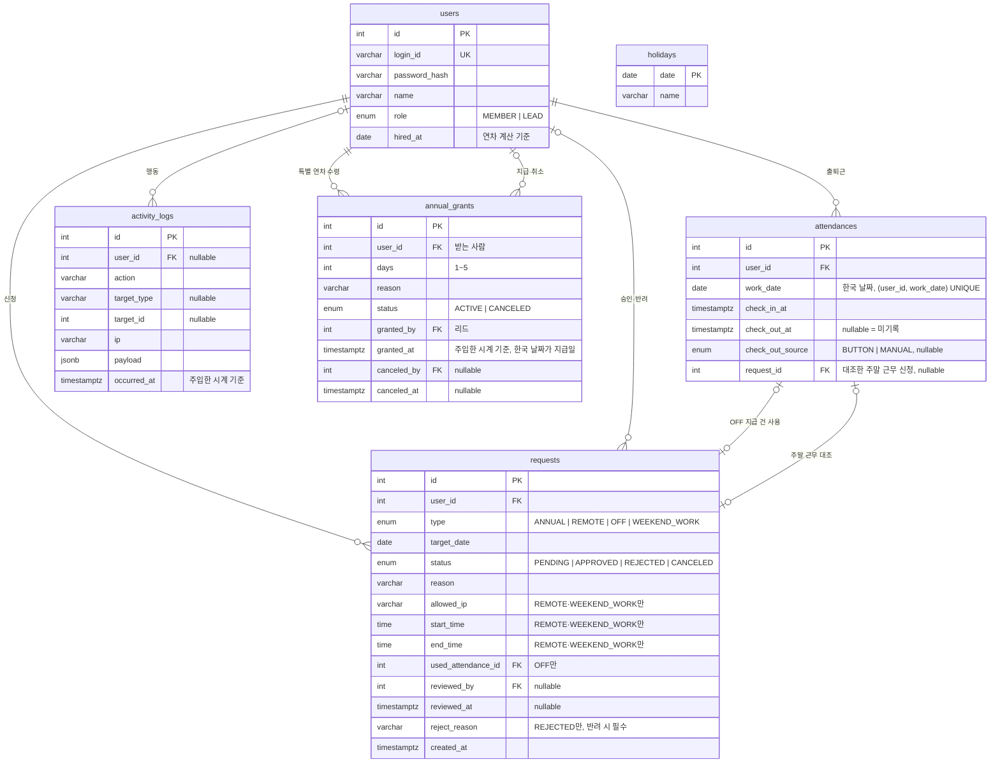

# 근태관리 시스템 설계

이 문서는 구현의 기준이다. 코드가 이 문서와 다르면 코드를 고치거나, 문서를 먼저 고친 뒤 구현한다.

## 0. 원칙

- **계산 결과는 저장하지 않고, 일어난 사실만 저장한다.**
  잔여(연차·재택·OFF), 연차 적립, OFF 지급, 지각·조퇴 여부는 저장하지 않고 조회할 때 계산한다.
- **현재 상태와 이력은 분리한다.** 비즈니스 로직은 `requests`, `attendances`만 읽는다. `activity_logs`는 쓰기 전용이며 어떤 로직도 읽지 않는다.
- **모든 날짜·시각 판정은 Asia/Seoul 기준, 주입한 시계로만 얻는다.**
- **제도 문구에 근거가 있으면 따르고, 애매하면 규칙을 정해 README에 적고, 없으면 구현하지 않는다.**

## 1. 사용자와 시드

| 이름 | 역할 | 입사일 |
| --- | --- | --- |
| 리드 | LEAD | 2026-01-01 (발문에 없어 팀 창설일로 설정) |
| 김근태 | MEMBER | 2026-01-01 |
| 연차원 | MEMBER | 2026-01-15 |
| 임자율 | MEMBER | 2026-02-12 |

## 2. 데이터 모델



- `id`는 `int GENERATED BY DEFAULT AS IDENTITY`. TypeScript에서 `number`로 다룬다.

### 제약 (PostgreSQL 부분 인덱스)

- `requests (user_id, target_date)` UNIQUE, `status IN ('PENDING','APPROVED')` 조건. 날짜당 유효 신청 1건.
- `requests (used_attendance_id)` UNIQUE, `status IN ('PENDING','APPROVED')` 조건. OFF 지급 건 중복 사용 방지.
- `attendances (user_id, work_date)` UNIQUE.

### 저장하지 않는 것

연차·재택·OFF 잔여, 연차 적립 내역, OFF 지급 내역, 지각·조퇴 여부.

## 3. 날짜 유형

하루는 아래 중 하나로 분류된다. 판정 함수는 이 유형을 입력으로 받는다.

| 유형 | 조건 |
| --- | --- |
| WORKDAY | 영업일, 해당 날짜 유효 신청 없음 |
| REMOTE | 영업일, 승인된 REMOTE 신청 |
| HALF_OFF | 영업일, 승인된 OFF 신청 |
| ANNUAL | 영업일, 승인된 ANNUAL 신청 |
| WEEKEND_WORK | 주말·공휴일, 승인된 WEEKEND_WORK 신청 |
| NON_WORKDAY | 주말·공휴일, 신청 없음 |

영업일 = 주말과 `holidays`에 없는 날.

## 4. 출퇴근

### 4-1. 판정표

| 유형 | 출근 가능 | 지각 | 퇴근 가능 | 조퇴(비정상) |
| --- | --- | --- | --- | --- |
| WORKDAY, REMOTE | 07:00부터 | 10:00:00 초과 | 16:00부터 | 근무 8시간 미만 |
| HALF_OFF | 07:00부터 | 판정 없음 | 제한 없음 | 근무 4시간 미만 |
| WEEKEND_WORK | 신청 시간대 안 | 판정 없음 | 신청 시간대 안 | 판정 없음 |
| ANNUAL | 출근 거부 | - | - | - |
| NON_WORKDAY | 출근 거부 | - | - | - |

- 지각 경계: 초 아래는 버린다. 10:00:00은 정상, 10:00:01은 지각.
- WEEKEND_WORK 출퇴근은 요청 IP가 신청의 `allowed_ip`와 같아야 한다. 출근 시 대조한 신청을 `attendances.request_id`에 저장한다.

### 4-2. 근무시간

```
근무시간 = 퇴근 − 출근 − 점심
점심 = (출근 ≤ 11:30 그리고 퇴근 ≥ 12:30) ? 1시간 : 0
```

- 제도 문구("구간이 근무에 포함될 때만")를 그대로 따른다.
- 비교는 초 단위(초 아래 버림). 11:30:30 출근은 점심 차감 없음.
- 한계: 11:29 출근과 11:31 출근이 근무시간 1시간 차이. 겹친 만큼 차감하는 안을 검토했으나 제도 문구를 따랐다. 점심 차감은 별도 함수로 분리해 교체 가능하게 한다.

| 출근 | 퇴근 | 근무시간 |
| --- | --- | --- |
| 09:00 | 18:00 | 8시간 |
| 12:00 | 16:00 | 4시간 |
| 08:00 | 12:00 | 4시간 |
| 11:31 | 20:00 | 8시간 29분 |
| 11:29 | 20:00 | 7시간 31분 |

### 4-3. 미기록 퇴근

- `check_out_at`이 비어 있는 과거 날짜가 있으면 **서버가 출근 등록을 거부**한다. 화면 모달만으로 막지 않는다.
- 직접 입력 허용 범위: 그날 출근 시각 이후 ~ 그날 23:59:59. 16:00 제한 없음.
  - 이유: 16:00 제한은 버튼 등록에만 해당한다. 직접 입력까지 막으면 일찍 나간 사람이 거짓 시각을 넣게 된다.
- WEEKEND_WORK의 직접 입력은 출근 이후 ~ 신청 종료 시각. `allowed_ip` 대조는 하지 않는다(버튼 출퇴근만 대조). 직접 입력은 보통 다음 영업일에 연구실에서 하기 때문이다.
- 직접 입력은 과거 날짜만. 오늘 기록은 퇴근 버튼으로 등록한다.
- `check_out_source = MANUAL`로 저장하고, 조퇴는 근무시간으로 자동 판정.
- 자정을 넘기면 그날은 미기록이 된다(하루 한 행).

## 5. 신청

### 5-1. 공통

- 상태: PENDING → APPROVED | REJECTED, PENDING·APPROVED → CANCELED(본인, 대상일 전날까지).
- 리드 본인의 신청은 제출 즉시 APPROVED(`reviewed_by` = 본인). 기한·잔여 검사는 똑같이 받는다.
- 사유는 필수(1~500자). 리드가 반려할 때도 반려 사유가 필수(1~500자, `reject_reason`)이며 신청 목록·승인 화면·PDF에 보인다. 이 규칙 전에 반려된 건은 비어 있다(`-`로 표시). REMOTE·WEEKEND_WORK의 `allowed_ip`는 정규화(`::ffff:` 제거)해서 저장한다.
- 승인은 대상일 0시(KST) 전까지만 가능. 대상일이 지난 PENDING은 반려만 가능.
  - 이유: 대기 중에 출근한 날이 나중에 연차·반일 OFF로 바뀌면 판정이 꼬인다.
- 날짜 유형(3장)은 APPROVED 신청만 반영한다. PENDING은 유형을 바꾸지 않는다.
- 기한: 대상일 **직전 영업일 17:00:00까지**. 예: 2026-09-28(월) 신청은 추석 연휴와 주말을 건너 2026-09-23(수) 17:00:00까지.
- 날짜 검증: ANNUAL·REMOTE·OFF는 영업일만, WEEKEND_WORK는 주말·공휴일만.
- 잔여 부족, 기한 초과, 날짜 오류는 **제출 거절**(행을 만들지 않음). 반려(REJECTED)와 구분한다.
- 잔여 계산 시 PENDING과 APPROVED를 모두 사용으로 센다.
- 판정 순서: 날짜 → 기한 → 같은 날 중복 → 잔여. 같은 사용자의 제출은 사용자 행 잠금으로 줄 세운다.

### 5-2. 연차 (ANNUAL, 1일 단위)

```
적립 개수(오늘) = 입사일 다음 달 같은 날부터 오늘까지 도래한 적립일 수
특별 지급(오늘) = 오늘까지 받고 오늘까지 취소되지 않은 특별 연차 일수 합 (14-3)
잔여 = 적립 개수(오늘) + 특별 지급(오늘) − (PENDING + APPROVED 연차 수)
제출 조건: 잔여 ≥ 1
```

- 첫 적립: 입사 한 달 뒤 같은 날. 해당 일이 없는 달은 말일.
- 적립일 0시(KST)부터 포함.
- 신청 시점 잔여로 검사한다. 아직 생기지 않은 연차로는 미래 날짜도 신청할 수 없다.
- 적립 함수는 분리한다. 특별 지급은 원천으로 더한다(14-3).
- 상한을 두지 않고 위 공식을 그대로 따른다(1년 이후 규칙은 11장대로 구현 안 함).

| 사용자 | 오늘 | 적립 |
| --- | --- | --- |
| 임자율(02-12) | 2026-03-11 | 0 |
| 임자율(02-12) | 2026-03-12 | 1 |
| 임자율(02-12) | 2026-11-11 | 8 |
| 임자율(02-12) | 2026-11-12 | 9 |
| 김근태(01-01) | 2026-01-31 | 0 |
| 김근태(01-01) | 2026-02-01 | 1 |

### 5-3. 재택 (REMOTE)

```
제출 조건: 재택일이 속한 달력 월의 (PENDING + APPROVED 재택 수) < 2
```

- 신청일이 아니라 재택일이 속한 달로 센다. 11월에 2회를 쓴 사람도 12/1 재택을 신청할 수 있다.
- 이월 없음은 달마다 그 달 신청만 세므로 자동으로 성립.
- 잔여 조회는 이번 달과 다음 달을 함께 보여준다.
- `allowed_ip`, `start_time`, `end_time` 필수.

### 5-4. OFF (반일, OFF)

지급:
- 지급 건 = `request_id`가 WEEKEND_WORK 신청을 가리키고 `check_out_at`이 기록된 출퇴근 행.
- 지급일 = 그 행의 `work_date`(직접 입력으로 늦게 기록해도 근무일).
- 최소 근무시간 조건은 없다. 10분만 일해도 지급된다. 4시간 조건을 검토했으나 제도 문구를 우선했고, 주말 근무 자체를 리드 승인으로 통제한다. 필요하면 지급 판정 함수에 조건 하나를 추가하면 된다.

사용:
- 지급일 ≤ 사용일 ≤ 지급일 + 30일(당일 포함). 예: 11/14 근무 → 12/14까지 사용, 12/15부터 만료.
- 사용일에 유효하고, 다른 PENDING·APPROVED 신청이 가리키지 않는 지급 건 중 **가장 먼저 받은 것**을 골라 `used_attendance_id`에 저장한다.
- 고를 건이 없으면 제출 거절. 메시지는 보유한 지급 건마다 사용일 기준으로 왜 못 쓰는지 한 줄씩 보여준다(만료: 마지막 사용 가능일, 사용 중, 아직 지급 전). 보유 건이 없으면 "보유한 OFF가 없습니다."
- 취소·반려되면 지급 건이 풀린다.
- 잔여 = 오늘 기준 만료되지 않았고 아무 유효 신청도 가리키지 않는 지급 건 수.

| 보유 | 사용일 | 선택 |
| --- | --- | --- |
| A(11/14 근무, ~12/14), B(12/5 근무, ~1/4) | 12/10 | A |
| 위와 동일 | 12/20 | B (A 만료) |

### 5-5. 주말·공휴일 근무 (WEEKEND_WORK)

- `allowed_ip`, `start_time`, `end_time` 필수. 잔여 검사 없음.

## 6. 접속 제한 (IP)

```
1단계 (모든 요청, 로그인 전 포함)
  연구실 IP(env LAB_IPS)면 통과.
  아니면: 현재 시각이 시간대 안이고 이 IP를 적은 APPROVED
  REMOTE·WEEKEND_WORK 신청이 하나라도 있어야 통과. 없으면 403.
2단계 (인증 이후)
  연구실 IP가 아니면, 그 신청이 로그인한 본인 것이어야 함.
```

- 시간대 판정: 한국 날짜가 대상일이고 `start_time ≤ 현재 ≤ end_time`(양 끝 포함, 초 아래 버림).
- 로그인에도 2단계를 적용한다. 연구실 밖에서는 비밀번호가 맞아도 그 신청의 본인이 아니면 403, 토큰을 발급하지 않는다.
- 거절 응답은 403 `{ code: 'IP_NOT_ALLOWED' }`. 화면은 이 코드로 "등록된 IP가 아닙니다"를 띄운다.
- 클라이언트 IP: Vite 프록시 `xfwd: true` + Express `trust proxy = 'loopback'`. `true` 금지(헤더 위조로 우회 가능).
- IP 정규화: `::ffff:` 접두사 제거 후 비교.
- 재택 신청은 집에서 할 수 없다(승인 전엔 집 IP가 막힘). 전 영업일 연구실에서 신청하는 흐름.
- 로컬 재택 테스트: `localhost` 대신 내부망 IP(예: `http://192.168.0.5:5173`)로 접속.

## 7. 공휴일

- 원천: 공공데이터포털 한국천문연구원 특일 정보 API.
- 앱은 `holidays` 테이블만 읽는다. 외부 API를 요청 처리 중에 부르지 않는다.
- 서버 시작 시 테이블이 비어 있으면 저장소의 시드 파일로 채운다(네트워크 불필요).
- 동기화는 CLI로 수동 실행, 키는 `.env`. 키가 없으면 안내 후 종료.
- 시드 파일은 동기화 결과를 커밋해서 만든다.

## 8. 시계

- 모든 "현재 시각"은 Clock provider에서 얻는다. `new Date()`, `Date.now()`, DB `now()` 금지.
- 개발 모드에서 시각을 바꿀 수 있어야 한다(과제 참고 사항). 운영 모드에서는 비활성.
- 방식은 13장 참고.

## 9. 이력 (FR-LOG-01)

- 모든 상태 변경 요청(로그인 성공·실패, 출퇴근, 직접 입력, 신청, 취소, 승인, 반려)과 거절된 시도를 남긴다.
- 공통 칸: 사용자, 행동, 대상, IP, 시각. 행동별 상세는 `payload`(jsonb), 모양은 코드의 타입으로 강제.
- IP 가드·역할 거절은 상태 변경 요청(GET·HEAD·OPTIONS 외)일 때만 남긴다.
- 제출 거절(`REQUEST_SUBMIT_REFUSED`)과 반려(`REQUEST_REJECTED`)는 다른 행동으로 남긴다.
- 로그인 실패 `payload`에는 시도한 `loginId`만 넣는다. 비밀번호는 절대 넣지 않는다. 아이디 없음과 비밀번호 틀림은 같은 401 메시지로 응답한다.

## 10. 화면

- 팀원: 내 카드(오늘 출퇴근·근무시간·잔여), 출퇴근 버튼, 미기록 퇴근 입력 모달, 신청서, 내 신청 목록.
- 내 카드는 근무 중일 때 "정상 퇴근 가능 HH:MM:SS 이후"를 보여준다. 서버가 순수 함수(`normalCheckOutFrom`)로 계산하고 화면은 계산하지 않는다.
  - 정의: 그 시각 이후 그날 언제 퇴근해도 버튼 퇴근이 허용되고 조퇴가 아닌 가장 이른 시각. 4-1의 퇴근 가능·조퇴 기준과 4-2의 근무시간을 그대로 쓴다.
  - WORKDAY·REMOTE: 8시간 그리고 16:00 이후. HALF_OFF: 4시간. WEEKEND_WORK는 표시하지 않는다.
  - 점심 차감 때문에 반일 OFF로 07:30 초과 08:30 미만에 출근하면 4시간을 처음 채운 뒤 12:30~에 다시 조퇴 구간이 생긴다. 이때는 그 구간이 끝나는 시각을 보여준다(08:00 출근 → 12:00이 아니라 13:00).

| 출근 | 유형 | 정상 퇴근 가능 |
| --- | --- | --- |
| 09:59:34 | WORKDAY | 18:59:34 |
| 11:31 | WORKDAY | 19:31 |
| 07:00 | WORKDAY | 16:00 |
| 08:00 | HALF_OFF | 13:00 |
| 11:31 | HALF_OFF | 15:31 |

- 리드: 팀원 기능 + 팀 보드(오늘 팀원별 출근·재택·연차·OFF·미출근, 지각 표시), 미기록·직접 입력 건 목록, 승인·반려.
- 팀 보드는 리드를 포함한 전원. 날짜 유형(승인된 신청만 반영)과 출근 상태(미출근·근무 중·퇴근, 연차·휴무일은 표시 없음)를 따로 보여준다.
- 미기록·직접 입력 목록은 월 단위(기본 이번 달). 오늘 아직 퇴근 전인 행은 미기록이 아니다.
- 앱 시작 시 접속 가능 여부를 먼저 확인하고, IP 1단계에 막히면 "등록된 IP가 아닙니다" 화면을 보여준다.
- 미기록 퇴근이 있으면 내 근태 화면에서 입력 모달을 자동으로 연다(출근 거부는 서버가 한다).

## 11. 범위

| 구분 | 항목 |
| --- | --- |
| 필수 | FR-SYS-01, 02 / FR-ATT-01~04 / FR-REQ-01 / FR-BAL-01 / FR-DSH-01 / FR-LOG-01 |
| 선택(순서대로) | FR-REQ-02 승인·반려 → FR-STL-01 월별 정산 → FR-REQ-03 PDF |
| 여유 시 | 리드의 특별 연차 지급 (적립 함수에 원천 추가, 14-3) |
| 구현 안 함, README 확장 아이디어 | 1년 이후 연차 규칙(근로기준법 15일), 연차별 기본값 |

## 12. README에 적을 한계

- 연차 규칙 변경 시 과거 적립까지 소급 반영됨(계산 방식의 특성).
- OFF 지급에 최소 근무시간 조건 없음. 10분만 일해도 지급. 4시간 조건을 검토했으나 제도 문구를 우선했고 리드 승인으로 통제. 필요 시 지급 판정 함수에 조건 하나 추가(5-4).
- 날짜당 신청 1건이라 재택과 반일 OFF를 같은 날 쓰거나 반일 OFF 두 개로 하루를 쉴 수 없음.
- 점심 차감 경계의 불연속(4-2).
- 대기 건이 늦게 반려되면 재신청 기한이 지났을 수 있음.
- 월별 정산의 과거 잔여는 기준일 뒤의 신청 취소·반려를 구분하지 못함(14-1). 특별 연차는 취소 시각을 저장해 정확함(14-3).

## 13. 구현 전 결정

### 결정됨

- **인증 방식**: JWT를 httpOnly 쿠키에 담는다. `SameSite=Strict`.
  - 이유: IP·시간대는 요청마다 가드가 다시 검사하므로 토큰 무효화(서버 측 폐기)가 필요 없고, 세션 저장소 없는 구성이 단순하다.
  - 쿠키는 maxAge 없는 세션 쿠키. 만료는 JWT `exp`(주입한 시계 기준, 기본 12시간)로만 판정한다. 브라우저 시계와 개발 모드 시계가 어긋나지 않게 하려는 것.
  - `Secure`는 `NODE_ENV=production`일 때만. 서명 키 `JWT_SECRET`은 `npm run setup`이 무작위로 채운다.

- **개발 모드 시계**: 실제 시각 + 오프셋(지정한 시각부터 계속 흐름). 서버 메모리에만 있어 재시작하면 실제 시각.
  - API: `GET/PUT/DELETE /api/dev/clock` (`PUT { now: ISO 8601 }`). 개발 모드에서만 등록(운영 모드 404). 로그인 없이 쓸 수 있고 IP 1단계는 적용.
  - 화면: 하단 막대(서버 현재 시각, 날짜·시각 입력, ±1일·+1시간, 07:00:00·09:59:30·10:00:30·16:00:00·17:00:00, 실제 시각으로). API가 없으면 숨김.
    - 시계가 흐르므로 지각 경계는 정각 대신 09:59:30(정상)·10:00:30(지각)으로 확인한다. 10:00:00 정각 경계는 단위 테스트로 검증한다.
  - **테스트 데이터 초기화**(개발 모드 전용): `POST /api/dev/reset`. 출퇴근·신청·특별 연차·이력을 비우고(TRUNCATE) 시계를 실제 시각으로 되돌린다. 사용자·공휴일은 유지. 화면은 시계 막대의 버튼, 누르기 전에 확인 창. 운영 모드에서는 404·버튼 없음.
    - "행을 삭제하지 않는다", "이력은 쓰기 전용" 규칙의 유일한 예외다. 테스트 반복을 위한 개발 도구이고 운영 코드 경로에는 없다.
  - JWT 만료도 이 시계를 따른다. 개발용 `.env.example`은 `JWT_EXPIRES_HOURS=168`(7일)이라 하루씩 옮겨도 로그인이 유지되고, 운영은 12 권장.

### 미정

(없음)

## 14. 선택 기능

### 14-1. 월별 정산 (FR-STL-01)

- 저장하지 않고 조회할 때 출퇴근 행과 그 달 대상일의 APPROVED 신청으로 계산한다(`domain/settlement.ts`).
- 리드는 전원 요약(`GET /api/settlements?month=`)과 한 사람의 일별 상세(`GET /api/settlements/:userId`), 팀원은 본인만(`GET /api/settlements/me`). 기본 이번 달.
- 과제 원문의 정산 항목 "근무일·근무시간·지각·조퇴·잔여"를 모두 담는다.
- 요약 항목: 근무일(출근 기록이 있는 날 수), 총 근무시간(퇴근 기록된 행, 주말 근무 포함), 지각, 조퇴, 결근, 미기록, 직접 입력, 연차·재택·반일 OFF 사용(그 달 대상일의 승인 건수), 주말·공휴일 근무 일수·시간, OFF 지급 건수, 잔여(연차·재택·OFF).
- 잔여 기준일: 지난 달이면 그달 말일, 이번 달(과 미래 달)이면 오늘.
  - 연차 잔여 = 기준일까지 적립 − 지금 유효(PENDING·APPROVED)한 연차 중 기준일까지 제출한 것.
  - 재택 잔여 = 2 − 그 달 대상일의 유효 재택 수(재택은 원래 달 단위라 기준일과 무관).
  - OFF 잔여 = 기준일까지 지급됐고 기준일에 만료되지 않았으며, 기준일까지 제출한 유효 OFF가 가리키지 않는 지급 건 수.
  - 한계: 신청 테이블에는 현재 상태만 있고(취소 시각 없음) 이력은 로직에서 읽지 않으므로, 기준일 뒤에 취소·반려된 신청은 기준일에도 없었던 것처럼 계산된다.
- 결근 = 출근해야 하는 날(근무일·재택·반일 OFF)이 오늘 이전인데 출근 기록이 없음. 입사일 전 날짜와 연차·휴무일은 제외.
- 미기록 = 오늘 이전 날짜이고 퇴근 없음. 오늘 퇴근 전인 행은 세지 않는다.

### 14-2. 신청서 PDF (FR-REQ-03)

- 서버가 pdfkit으로 만들어 내려준다(`GET /api/requests/:id/pdf`). 본인 또는 리드만, 남의 신청은 404.
- 항목: 신청 번호, 신청자, 유형, 대상일, (재택·주말 근무) 접속 IP·시간대, (OFF) 사용한 지급 건과 만료일, 사유, 신청 일시, 상태, (승인·반려) 처리자·처리 일시, (반려) 반려 사유, 출력 일시.
- 파일 이름: `근태신청서_{이름}_{유형}_{대상일}.pdf` (예: `근태신청서_김근태_연차_2026-11-18.pdf`). 유형 이름의 공백은 `_`로 바꾼다. 한글 이름은 `Content-Disposition`의 `filename*`(UTF-8)로 보낸다.
- 취소된 신청은 처리자를 적지 않는다(`reviewed_by`가 이전 승인자일 수 있음).
- 출력 일시와 PDF 생성 시각 메타데이터는 주입한 시계 값. 한글은 저장소의 나눔고딕(`backend/assets/fonts`, SIL OFL 1.1).

### 14-3. 리드의 특별 연차 지급

- 지급은 일어난 사실이라 `annual_grants`에 저장한다. 잔여·적립은 여전히 저장하지 않고, 적립 함수의 원천으로 더해 계산한다(5-2).
- 리드만 지급·취소한다. **본인에게는 지급할 수 없다**(리드 본인 신청은 즉시 승인이라 확인할 사람이 없음).
- 1회 1~5일, 사유 필수(1~500자). 지급 즉시 효력(지급일 = `granted_at`의 한국 날짜). 만료 없음(일반 연차처럼 상한 없음).
- **취소**: 행을 지우지 않고 `status = CANCELED`, `canceled_by`, `canceled_at`을 채운다. CANCELED 지급분은 잔여 계산에서 빠진다.
  - 취소하면 잔여가 음수가 되는 경우(이미 그 연차를 신청에 써버린 경우)는 거절한다. 판정: `현재 잔여 − 지급 일수 ≥ 0`. 거절 메시지에 현재 잔여·지급 일수·취소 후 잔여를 보여주고, 먼저 연차 신청을 취소·반려하라고 안내한다.
  - 같은 사용자의 연차 신청 제출과 겹치지 않도록 지급·취소도 사용자 행 잠금으로 줄 세운다.
- 이력: `ANNUAL_GRANTED`, `ANNUAL_GRANT_CANCELED`, 거절된 시도는 `ANNUAL_GRANT_ACTION_REFUSED`.
- 월별 정산의 기준일 잔여는 기준일 시점에 유효했던 지급분(기준일까지 지급, 기준일까지 취소 안 됨)을 더한다. 신청과 달리 취소 시각(`canceled_at`)을 저장하므로 과거 기준일도 정확하다.
- API: `POST /api/annual-grants` `{ userId, days, reason }`, `GET /api/annual-grants`, `POST /api/annual-grants/:id/cancel` (모두 리드).
- 화면: 리드 "특별 연차"(지급 폼, 지급 내역과 취소). 팀원은 잔여 카드에서 특별 지급 일수를 본다.
