# 근태관리 시스템 설계

이 문서는 구현의 기준이다. 코드가 이 문서와 다르면 코드를 고치거나, 문서를 먼저 고친 뒤 구현한다.

## 0. 원칙

- **계산 결과는 저장하지 않고, 일어난 사실만 저장한다.**
  잔여(연차·재택·OFF), 연차 적립, OFF 지급, 지각·조퇴 여부는 저장하지 않고 조회할 때 계산한다.
- **현재 상태와 이력은 분리한다.** 비즈니스 로직은 `requests`, `attendances`만 읽는다. `activity_logs`는 쓰기 전용이며 어떤 로직도 읽지 않는다.
- **모든 날짜·시각 판정은 Asia/Seoul 기준, 주입한 시계로만 얻는다.**
- **제도 문구에 근거가 있으면 따르고, 애매하면 규칙을 정해 README에 적고, 없으면 구현하지 않는다.**

## 1. 사용자와 시드

| 이름 | 역할 | 입사일 |
| --- | --- | --- |
| 리드 | LEAD | 2026-01-01 (발문에 없어 팀 창설일로 설정) |
| 김근태 | MEMBER | 2026-01-01 |
| 연차원 | MEMBER | 2026-01-15 |
| 임자율 | MEMBER | 2026-02-12 |

## 2. 데이터 모델

```mermaid
erDiagram
    users ||--o{ attendances : "출퇴근"
    users ||--o{ requests : "신청"
    users |o--o{ requests : "승인·반려"
    users |o--o{ activity_logs : "행동"
    requests |o--o| attendances : "주말 근무 대조"
    attendances |o--o| requests : "OFF 지급 건 사용"

    users {
        int id PK
        varchar login_id UK
        varchar password_hash
        varchar name
        enum role "MEMBER | LEAD"
        date hired_at "연차 계산 기준"
    }

    attendances {
        int id PK
        int user_id FK
        date work_date "한국 날짜, (user_id, work_date) UNIQUE"
        timestamptz check_in_at
        timestamptz check_out_at "nullable = 미기록"
        enum check_out_source "BUTTON | MANUAL, nullable"
        int request_id FK "대조한 주말 근무 신청, nullable"
    }

    requests {
        int id PK
        int user_id FK
        enum type "ANNUAL | REMOTE | OFF | WEEKEND_WORK"
        date target_date
        enum status "PENDING | APPROVED | REJECTED | CANCELED"
        varchar reason
        varchar allowed_ip "REMOTE·WEEKEND_WORK만"
        time start_time "REMOTE·WEEKEND_WORK만"
        time end_time "REMOTE·WEEKEND_WORK만"
        int used_attendance_id FK "OFF만"
        int reviewed_by FK "nullable"
        timestamptz reviewed_at "nullable"
        timestamptz created_at
    }

    activity_logs {
        int id PK
        int user_id FK "nullable"
        varchar action
        varchar target_type "nullable"
        int target_id "nullable"
        varchar ip
        jsonb payload
        timestamptz occurred_at "주입한 시계 기준"
    }

    holidays {
        date date PK
        varchar name
    }
```



- `id`는 `int GENERATED BY DEFAULT AS IDENTITY`. TypeScript에서 `number`로 다룬다.

### 제약 (PostgreSQL 부분 인덱스)

- `requests (user_id, target_date)` UNIQUE, `status IN ('PENDING','APPROVED')` 조건. 날짜당 유효 신청 1건.
- `requests (used_attendance_id)` UNIQUE, `status IN ('PENDING','APPROVED')` 조건. OFF 지급 건 중복 사용 방지.
- `attendances (user_id, work_date)` UNIQUE.

### 저장하지 않는 것

연차·재택·OFF 잔여, 연차 적립 내역, OFF 지급 내역, 지각·조퇴 여부.

## 3. 날짜 유형

하루는 아래 중 하나로 분류된다. 판정 함수는 이 유형을 입력으로 받는다.

| 유형 | 조건 |
| --- | --- |
| WORKDAY | 영업일, 해당 날짜 유효 신청 없음 |
| REMOTE | 영업일, 승인된 REMOTE 신청 |
| HALF_OFF | 영업일, 승인된 OFF 신청 |
| ANNUAL | 영업일, 승인된 ANNUAL 신청 |
| WEEKEND_WORK | 주말·공휴일, 승인된 WEEKEND_WORK 신청 |
| NON_WORKDAY | 주말·공휴일, 신청 없음 |

영업일 = 주말과 `holidays`에 없는 날.

## 4. 출퇴근

### 4-1. 판정표

| 유형 | 출근 가능 | 지각 | 퇴근 가능 | 조퇴(비정상) |
| --- | --- | --- | --- | --- |
| WORKDAY, REMOTE | 07:00부터 | 10:00:00 초과 | 16:00부터 | 근무 8시간 미만 |
| HALF_OFF | 07:00부터 | 판정 없음 | 제한 없음 | 근무 4시간 미만 |
| WEEKEND_WORK | 신청 시간대 안 | 판정 없음 | 신청 시간대 안 | 판정 없음 |
| ANNUAL | 출근 거부 | - | - | - |
| NON_WORKDAY | 출근 거부 | - | - | - |

- 지각 경계: 초 아래는 버린다. 10:00:00은 정상, 10:00:01은 지각.
- WEEKEND_WORK 출퇴근은 요청 IP가 신청의 `allowed_ip`와 같아야 한다. 출근 시 대조한 신청을 `attendances.request_id`에 저장한다.

### 4-2. 근무시간

```
근무시간 = 퇴근 − 출근 − 점심
점심 = (출근 ≤ 11:30 그리고 퇴근 ≥ 12:30) ? 1시간 : 0
```

- 제도 문구("구간이 근무에 포함될 때만")를 그대로 따른다.
- 한계: 11:29 출근과 11:31 출근이 근무시간 1시간 차이. 겹친 만큼 차감하는 안을 검토했으나 제도 문구를 따랐다. 점심 차감은 별도 함수로 분리해 교체 가능하게 한다.

| 출근 | 퇴근 | 근무시간 |
| --- | --- | --- |
| 09:00 | 18:00 | 8시간 |
| 12:00 | 16:00 | 4시간 |
| 08:00 | 12:00 | 4시간 |
| 11:31 | 20:00 | 8시간 29분 |
| 11:29 | 20:00 | 7시간 31분 |

### 4-3. 미기록 퇴근

- `check_out_at`이 비어 있는 과거 날짜가 있으면 **서버가 출근 등록을 거부**한다. 화면 모달만으로 막지 않는다.
- 직접 입력 허용 범위: 그날 출근 시각 이후 ~ 그날 23:59:59. 16:00 제한 없음.
  - 이유: 16:00 제한은 버튼 등록에만 해당한다. 직접 입력까지 막으면 일찍 나간 사람이 거짓 시각을 넣게 된다.
- WEEKEND_WORK의 직접 입력은 출근 이후 ~ 신청 종료 시각.
- `check_out_source = MANUAL`로 저장하고, 조퇴는 근무시간으로 자동 판정.
- 자정을 넘기면 그날은 미기록이 된다(하루 한 행).

## 5. 신청

### 5-1. 공통

- 상태: PENDING → APPROVED | REJECTED, PENDING·APPROVED → CANCELED(본인, 대상일 전날까지).
- 리드 본인의 신청은 제출 즉시 APPROVED.
- 기한: 대상일 **직전 영업일 17:00:00까지**. 예: 2026-09-28(월) 신청은 추석 연휴와 주말을 건너 2026-09-23(수) 17:00:00까지.
- 날짜 검증: ANNUAL·REMOTE·OFF는 영업일만, WEEKEND_WORK는 주말·공휴일만.
- 잔여 부족, 기한 초과, 날짜 오류는 **제출 거절**(행을 만들지 않음). 반려(REJECTED)와 구분한다.
- 잔여 계산 시 PENDING과 APPROVED를 모두 사용으로 센다.

### 5-2. 연차 (ANNUAL, 1일 단위)

```
적립 개수(오늘) = 입사일 다음 달 같은 날부터 오늘까지 도래한 적립일 수
잔여 = 적립 개수(오늘) − (PENDING + APPROVED 연차 수)
제출 조건: 잔여 ≥ 1
```

- 첫 적립: 입사 한 달 뒤 같은 날. 해당 일이 없는 달은 말일.
- 적립일 0시(KST)부터 포함.
- 신청 시점 잔여로 검사한다. 아직 생기지 않은 연차로는 미래 날짜도 신청할 수 없다.
- 적립 함수는 분리한다(나중에 특별 지급 등 원천 추가 대비).

| 사용자 | 오늘 | 적립 |
| --- | --- | --- |
| 임자율(02-12) | 2026-03-11 | 0 |
| 임자율(02-12) | 2026-03-12 | 1 |
| 임자율(02-12) | 2026-11-11 | 8 |
| 임자율(02-12) | 2026-11-12 | 9 |
| 김근태(01-01) | 2026-01-31 | 0 |
| 김근태(01-01) | 2026-02-01 | 1 |

### 5-3. 재택 (REMOTE)

```
제출 조건: 재택일이 속한 달력 월의 (PENDING + APPROVED 재택 수) < 2
```

- 신청일이 아니라 재택일이 속한 달로 센다. 11월에 2회를 쓴 사람도 12/1 재택을 신청할 수 있다.
- 이월 없음은 달마다 그 달 신청만 세므로 자동으로 성립.
- `allowed_ip`, `start_time`, `end_time` 필수.

### 5-4. OFF (반일, OFF)

지급:
- 지급 건 = `request_id`가 WEEKEND_WORK 신청을 가리키고 `check_out_at`이 기록된 출퇴근 행.
- 지급일 = 그 행의 `work_date`(직접 입력으로 늦게 기록해도 근무일).

사용:
- 사용일 ≤ 지급일 + 30일(당일 포함). 예: 11/14 근무 → 12/14까지 사용, 12/15부터 만료.
- 사용일에 유효하고, 다른 PENDING·APPROVED 신청이 가리키지 않는 지급 건 중 **가장 먼저 받은 것**을 골라 `used_attendance_id`에 저장한다.
- 고를 건이 없으면 제출 거절.
- 취소·반려되면 지급 건이 풀린다.
- 잔여 = 오늘 기준 만료되지 않았고 아무 유효 신청도 가리키지 않는 지급 건 수.

| 보유 | 사용일 | 선택 |
| --- | --- | --- |
| A(11/14 근무, ~12/14), B(12/5 근무, ~1/4) | 12/10 | A |
| 위와 동일 | 12/20 | B (A 만료) |

### 5-5. 주말·공휴일 근무 (WEEKEND_WORK)

- `allowed_ip`, `start_time`, `end_time` 필수. 잔여 검사 없음.

## 6. 접속 제한 (IP)

```
1단계 (모든 요청, 로그인 전 포함)
  연구실 IP(env LAB_IPS)면 통과.
  아니면: 현재 시각이 시간대 안이고 이 IP를 적은 APPROVED
  REMOTE·WEEKEND_WORK 신청이 하나라도 있어야 통과. 없으면 403.
2단계 (인증 이후)
  연구실 IP가 아니면, 그 신청이 로그인한 본인 것이어야 함.
```

- 클라이언트 IP: Vite 프록시 `xfwd: true` + Express `trust proxy = 'loopback'`. `true` 금지(헤더 위조로 우회 가능).
- IP 정규화: `::ffff:` 접두사 제거 후 비교.
- 재택 신청은 집에서 할 수 없다(승인 전엔 집 IP가 막힘). 전 영업일 연구실에서 신청하는 흐름.
- 로컬 재택 테스트: `localhost` 대신 내부망 IP(예: `http://192.168.0.5:5173`)로 접속.

## 7. 공휴일

- 원천: 공공데이터포털 한국천문연구원 특일 정보 API.
- 앱은 `holidays` 테이블만 읽는다. 외부 API를 요청 처리 중에 부르지 않는다.
- 서버 시작 시 테이블이 비어 있으면 저장소의 시드 파일로 채운다(네트워크 불필요).
- 동기화는 CLI로 수동 실행, 키는 `.env`. 키가 없으면 안내 후 종료.
- 시드 파일은 동기화 결과를 커밋해서 만든다.

## 8. 시계

- 모든 "현재 시각"은 Clock provider에서 얻는다. `new Date()`, `Date.now()`, DB `now()` 금지.
- 개발 모드에서 시각을 바꿀 수 있어야 한다(과제 참고 사항). 운영 모드에서는 비활성.

## 9. 이력 (FR-LOG-01)

- 모든 상태 변경 요청(로그인 성공·실패, 출퇴근, 직접 입력, 신청, 취소, 승인, 반려)과 거절된 시도를 남긴다.
- 공통 칸: 사용자, 행동, 대상, IP, 시각. 행동별 상세는 `payload`(jsonb), 모양은 코드의 타입으로 강제.

## 10. 화면

- 팀원: 내 카드(오늘 출퇴근·근무시간·잔여), 출퇴근 버튼, 미기록 퇴근 입력 모달, 신청서, 내 신청 목록.
- 리드: 팀원 기능 + 팀 보드(오늘 팀원별 출근·재택·연차·OFF·미출근, 지각 표시), 미기록·직접 입력 건 목록, 승인·반려.

## 11. 범위

| 구분 | 항목 |
| --- | --- |
| 필수 | FR-SYS-01, 02 / FR-ATT-01~04 / FR-REQ-01 / FR-BAL-01 / FR-DSH-01 / FR-LOG-01 |
| 선택(순서대로) | FR-REQ-02 승인·반려 → FR-STL-01 월별 정산 → FR-REQ-03 PDF |
| 여유 시 | 리드의 특별 연차 지급 (적립 함수에 원천 추가) |
| 구현 안 함, README 확장 아이디어 | 1년 이후 연차 규칙(근로기준법 15일), 연차별 기본값 |

## 12. README에 적을 한계

- 연차 규칙 변경 시 과거 적립까지 소급 반영됨(계산 방식의 특성).
- OFF 지급에 최소 근무시간 조건 없음(제도에 없음, 리드 승인으로 통제).
- 날짜당 신청 1건이라 재택과 반일 OFF를 같은 날 쓰거나 반일 OFF 두 개로 하루를 쉴 수 없음.
- 점심 차감 경계의 불연속(4-2).
- 대기 건이 늦게 반려되면 재신청 기한이 지났을 수 있음.

## 13. 미정 (구현 전 결정)

- 인증 방식 (세션 vs JWT, 토큰 보관 위치)
- 개발 모드 시계 조작 방법 (API, 화면 컨트롤 형태)
